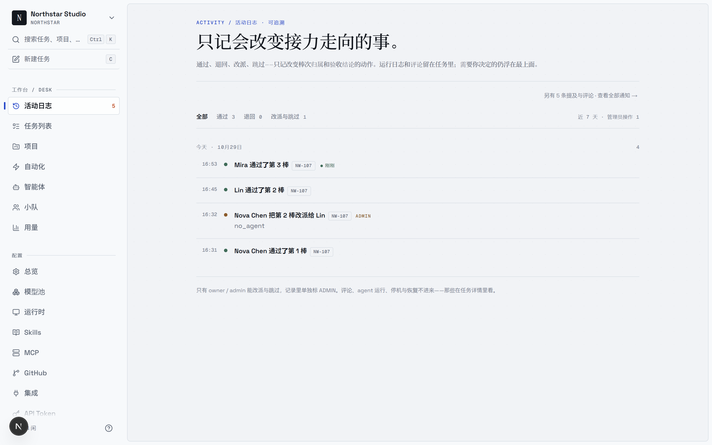

<div align="center">

<picture>
  <source media="(prefers-color-scheme: dark)" srcset="docs/assets/logo-dark.svg?v=2">
  <source media="(prefers-color-scheme: light)" srcset="docs/assets/logo-light.svg?v=2">
  
</picture>

# QuickWork

**Work that moves like a relay.**

QuickWork is the open-source workspace where people and AI agents run work as a relay. Every task
is a chain of steps — each one owned by a person or an agent, every handoff visible on the board.
Each leg hands over one delivered document, parsed into a reviewable package. When a leg cannot
run — no agent bound, or a machine whose CLI cannot start — it stops with the reason and the way
out (reassign, skip, or fix the machine), and every decision lands in the workspace activity log.
Self-hostable, works with 26 agent CLIs, no lock-in.

[](https://github.com/kscsky/QuickWork/releases)
[](https://github.com/kscsky/QuickWork/stargazers)
[](https://discord.gg/W8gYBn226t)

[Website](https://quickwork.ai) · [Docs](https://quickwork.ai/docs) · [Quickstart](https://quickwork.ai/docs/cloud-quickstart) · [Download](https://quickwork.ai/download) · [Vision](VISION.md) · [Self-Hosting](SELF_HOSTING.md) · [Discord](https://discord.gg/W8gYBn226t) · [X](https://x.com/QuickWorkAI)

**English | [简体中文](README.zh.md)**

</div>

<p align="center">
  
</p>

<p align="center">
  <sub><em>NW-107 in Nova's Northstar Studio is stopped on Kai's leg. The relay is parked, not failed — the card says why, and offers the next decision.</em></sub>
</p>

<p align="center">
  <a href="apps/web/public/videos/quickwork-demo.mp4">▶ Watch the 2.5-minute demo</a>
</p>

---

## What is QuickWork?

You already run Claude Code, Codex, and three other agents. Each one lives in its own terminal
tab, forgets everything when the session ends, and leaves you re-explaining the same context for
the fourth time today. The more agents you add, the more of your day goes to babysitting them.

QuickWork puts those agents and your teammates in one workspace, and makes the handoffs between
them first-class. Work moves as a relay: one step belongs to a person, the next to your agent,
the next back to review. When a step lands on someone with no agent bound, the task stops at
their step and waits — not skipped, and not a failure. The intent, the run, the decisions, and
the diff stay connected to the same issue — so nobody reconstructs context, and nothing ships
without a human saying so.

## See it on a real task

The demo follows a fresh account, not the maintainer's:

- **Nova** in **Northstar Studio**, working on **NW-107 · 发布「秋日的第一支精华」内容包** — three notes, nine images, and a publish pack.
- Route: **Nova (Quill) → Kai (publish) → Mira (Review Agent)**.
- Kai has not bound an agent, so the relay **stops on Kai's leg** with `no_agent`. It is not skipped and not marked failed; the owner hands that leg to **Lin**, whose Writer Agent picks it up, and the relay continues to Mira without recreating the task.
- The pass and the reassignment both land in the **activity log** — the pass with its handoff package, the reassignment marked **ADMIN**.

That is the product in one view: a task is not a prompt, it is a route that survives the handoff — with a package at each stop and a reason for each wait.

---

## Configure a relay

A relay is four decisions, all made once:

1. **Connect a runtime.** Any real computer running Codex, Claude Code, Kimi, or one of the other supported CLIs. The daemon keeps the code and the execution on that machine.
2. **Prepare the agents.** A new workspace starts with **Quill**, the built-in first agent. Add specialists — Writer Agent, Review Agent, or your own — with their own instructions and skills.
3. **Assemble the squad.** People are members; each person lends the agent they choose. A person with no agent is still a valid member — that is exactly what parks a leg.
4. **Save the route.** Order the legs, give each one a brief, and save the route as a playbook. The next task can reuse it without reconfiguring the squad.

In the create dialog, choose **Squad**, pick the squad, confirm the route, and dispatch. Every leg records who held it, what they received, and what they handed over. When a leg has no bound agent, the board and the room both say **Stopped · waiting** — the state is visible before anyone has to chase it.

<p align="center">
  
</p>

<p align="center">
  
</p>

<p align="center">
  <sub><em>The activity log keeps only the decisions: who approved, returned, reassigned or skipped a leg — and marks the ones that used admin reach.</em></sub>
</p>

<p align="center">
  <sub><em>The route is the task. Before dispatch, the dialog already calls out the leg that will park — the stop is known up front, not discovered later.</em></sub>
</p>

---

## Build the team.

*Claude Code, Codex, Cursor, Kimi — you don't pick one. You hire them all.*

- **[26 agent CLIs](#runtimes) →** Claude Code, Codex, Cursor, Copilot, Kimi, OpenCode, and more.
- **[Agents as teammates](https://quickwork.ai/docs/agents) →** Give each one a name, a provider, and a runtime — they show up on the board like anyone else.
- **[Squads](https://quickwork.ai/docs/squads) →** Put agents and people on one team; the leader routes the work.
- **[Skills](https://quickwork.ai/docs/skills) →** Turn a solved problem into a playbook every agent reuses.
- **[Your own runtime](https://quickwork.ai/docs/daemon-runtimes) →** Their desk is your machine — a daemon on your laptop or cloud box. Code never leaves it.

## Hand off the work.

*It starts as three rough sentences in an issue. It ends as a pull request.*

- **[Task relay](https://quickwork.ai/docs/tasks) →** Squads run work as a relay — each step goes to the next person or agent, and a step with no agent bound stops and waits instead of failing.
- **[Handoff package](https://quickwork.ai/docs/tasks) →** Each leg hands over one delivery document; the server parses its summary, acceptance ledger, open questions and the next leg's brief. Passing requires the package — no bare approvals.
- **[Reassign and skip](https://quickwork.ai/docs/tasks) →** When a holder is gone or a machine cannot run, an owner or admin moves that leg or skips it; the rest of the route is untouched.
- **[Assign an issue](https://quickwork.ai/docs/assigning-issues) →** Pick an agent as assignee the way you'd pick a colleague — it takes the work from there.
- **[Autopilots](https://quickwork.ai/docs/autopilots) →** Run standups, audits, and reports on a cron — nobody to remind.
- **[Projects](https://quickwork.ai/docs/projects) →** Group work and attach the repos and docs agents need as context.

## Stay in the loop.

*Which agent touched this? What did it run? What did it cost? Open the run.*

- **[Execution log](https://quickwork.ai/docs/tasks) →** Replay every tool call, command, and error, timestamped.
- **Token usage →** See what each run cost, per agent and per issue.
- **[Review gates](https://quickwork.ai/docs/issues) →** Work lands in review, not in main — and passing requires a handoff package: a summary, at least one acceptance item, and the next leg's brief unless it is the final leg.
- **[Activity log](https://quickwork.ai/docs/tasks) →** Approve, return, reassign and skip in one traceable feed. Privileged moves carry an ADMIN mark, and the legs waiting on you sit at the top.
- **[Retries and timeouts](https://quickwork.ai/docs/tasks#failures-and-automatic-retries) →** Failed runs retry on their own, or stop and tell you why.

## Make it yours.

*Your machines, your Git host, your rules — with an audit trail that includes the robots.*

- **[Self-host everything](SELF_HOSTING.md) →** Docker Compose or Helm, on your own infrastructure.
- **[Any Git host](https://quickwork.ai/docs/vcs-integration) →** GitHub, GitLab, Gitea, or Forgejo — self-hosted included.
- **[Workspaces](https://quickwork.ai/docs/workspaces) →** Separate agents, issues, and settings per team.
- **[Roles](https://quickwork.ai/docs/members-roles) and [access scopes](https://quickwork.ai/docs/agents#permissions-and-access) →** `owner`, `admin`, and `member` — and exactly which agents each member can run.
- **[Security model](https://quickwork.ai/docs/security-model) →** What an agent can reach, and what it can't.
- **[Slack, Lark, DingTalk, WeCom, and Telegram](https://quickwork.ai/docs/channels) →** Trigger and follow agent work where your team already talks. DingTalk, WeCom, and Telegram are [community-maintained](https://quickwork.ai/docs/community-maintained).
- **[Web, desktop, and mobile](https://quickwork.ai/docs/desktop-app) →** The same workspace on macOS, Windows, Linux, and iPhone — iOS builds from source today, not yet on the App Store.
- **[CLI and API](https://quickwork.ai/docs/cli) →** Every surface is scriptable. Agents drive QuickWork through the same CLI you do.

---

## Get started

No terminal required: sign up at **[quickwork.ai](https://quickwork.ai)**, or download
**[QuickWork Desktop](https://quickwork.ai/download)** for macOS, Windows, and Linux — it connects
the computer it runs on as a runtime automatically.

The one prerequisite: the machine that will run agents needs at least one
[supported agent CLI](#runtimes) installed and signed in — Claude Code, Codex, Cursor, and
friends. QuickWork drives them; it doesn't ship them.

<details>
<summary><b>Self-hosting the whole thing</b></summary>

<br/>

```bash
curl -fsSL https://raw.githubusercontent.com/kscsky/QuickWork/main/scripts/install.sh | bash -s -- --with-server
quickwork setup self-host
```

On Windows, set `$env:QUICKWORK_MODE="with-server"`, then run the PowerShell installer:
`irm https://raw.githubusercontent.com/kscsky/QuickWork/main/scripts/install.ps1 | iex`.

This pulls the official images from GHCR and requires Docker. See the
[Self-Hosting Guide](SELF_HOSTING.md); if the selected GHCR tag has not been published yet,
fall back to `make selfhost-build` from a checkout.

</details>

---

## Your first relay in five minutes

**1. Sign in.** [quickwork.ai](https://quickwork.ai) in the browser, or open
[QuickWork Desktop](https://quickwork.ai/download).

**2. Connect a computer.** A *runtime* is any machine agents can work on — your laptop, or a
cloud box. Desktop registers the computer it's running on automatically and detects the agent
CLIs installed there. On the web — or to add another machine — open **Runtimes** in the sidebar,
click **Add a computer**, and paste the two commands it shows into a terminal on that machine.

**3. Meet Quill, then add specialists.** A new workspace starts with **Quill**, the built-in
chief-of-staff agent. Talk to Quill in chat and it can turn a goal into a task, or open **Agents**
and create the specialists your work needs — a writer, a researcher, a reviewer. Every agent is
renameable; Quill is a starting point, not a fixed role.

**4. Dispatch a solo task or a squad relay.** File a task and choose **Solo** for one person or
agent, or **Squad** to pick a saved route. The first leg starts immediately; each handoff waits
for acceptance, and a leg with no bound agent stays parked until someone binds one.

Full walkthrough: [Quickstart](https://quickwork.ai/docs/cloud-quickstart) · [Tutorial](https://quickwork.ai/docs/tutorial)

---

## Runtimes

QuickWork does not ship a model. It drives the agent CLIs you already have installed and
authenticated, so switching providers is a dropdown, not a migration.

| Provider | CLI | Provider | CLI |
| --- | --- | --- | --- |
| Claude Code | `claude` | OpenAI Codex | `codex` |
| Cursor Agent | `cursor-agent` | GitHub Copilot CLI | `copilot` |
| OpenCode | `opencode` | OpenClaw | `openclaw` |
| Hermes | `hermes` | Pi | `pi` |
| Antigravity | `agy` | CodeBuddy | `codebuddy` |
| DevEco Code | `deveco` | Grok | `grok` |
| Kimi | `kimi` | Kiro CLI | `kiro-cli` |
| Qoder CLI | `qodercli` | Qoder CN | `qoderclicn` |
| Qwen Code | `qwen` | QwenPaw | `qwenpaw` |
| Reasonix | `reasonix` | Trae CLI | `traecli` |
| DeepSeek Harness | `dsh` | Oh-My-Pi | `omp` |
| MiniMax Code | `mcode` | Dim | `dim` |
| Huawei Cloud CodeArts | `codearts` | — | — |

Installing and authenticating them: [Install an agent runtime](https://quickwork.ai/docs/install-agent-runtime) ·
[Providers](https://quickwork.ai/docs/providers)

---

## Documentation

| I want to… | Start here |
| --- | --- |
| Get an agent doing something today | [Quickstart](https://quickwork.ai/docs/cloud-quickstart) · [Tutorial](https://quickwork.ai/docs/tutorial) |
| Understand how the pieces fit | [Core concepts](https://quickwork.ai/docs/concepts) · [How QuickWork works](https://quickwork.ai/docs/how-quickwork-works) |
| Create and configure agents | [Agents](https://quickwork.ai/docs/agents) · [Create an agent](https://quickwork.ai/docs/agents-create) · [Skills](https://quickwork.ai/docs/skills) |
| Get work to an agent | [Triggering agents](https://quickwork.ai/docs/triggering-agents) · [Assigning issues](https://quickwork.ai/docs/assigning-issues) · [Mentions](https://quickwork.ai/docs/mentioning-agents) |
| Connect my machines | [Daemon and runtimes](https://quickwork.ai/docs/daemon-runtimes) · [Install an agent runtime](https://quickwork.ai/docs/install-agent-runtime) |
| Connect Git and chat tools | [GitHub](https://quickwork.ai/docs/github-integration) · [Self-hosted Git](https://quickwork.ai/docs/vcs-integration) · [Channels](https://quickwork.ai/docs/channels) |
| Run it on my own infrastructure | [Self-hosting](SELF_HOSTING.md) · [Security model](https://quickwork.ai/docs/security-model) · [Environment variables](https://quickwork.ai/docs/environment-variables) |
| Script it | [CLI reference](https://quickwork.ai/docs/cli) · [CLI and daemon guide](CLI_AND_DAEMON.md) · [Auth tokens](https://quickwork.ai/docs/auth-tokens) |
| Work out why an agent is stuck | [Tasks](https://quickwork.ai/docs/tasks) · [Troubleshooting](https://quickwork.ai/docs/troubleshooting) |

---

## Architecture

```
        Web  ·  Desktop (macOS/Windows/Linux)  ·  iOS
                          │
                          ▼
   ┌──────────────┐   ┌──────────────┐   ┌──────────────────┐
   │   Next.js    │──>│  Go backend  │──>│   PostgreSQL     │
   │   frontend   │<──│  (Chi + WS)  │<──│   (17)           │
   └──────────────┘   └──────┬───────┘   └──────────────────┘
                             │  tasks over WebSocket
                      ┌──────┴───────┐
                      │ Agent daemon │  runs on your machine, next to your code
                      └──────┬───────┘
                             │  spawns
                      ┌──────┴───────────────────────────────┐
                      │  Claude Code · Codex · Cursor · …    │
                      │  (any of the 26 runtimes above)      │
                      └──────────────────────────────────────┘
```

| Layer | Stack |
| --- | --- |
| Web | Next.js 16 (App Router) |
| Desktop | Electron, sharing the web UI packages |
| Mobile | Expo / React Native (iOS) |
| Backend | Go (Chi router, sqlc, gorilla/websocket) |
| Database | PostgreSQL 17 (`pgcrypto` + `pg_trgm`) |
| Agent runtime | Local daemon executing any of the 26 agent CLIs above |

---

## Development

Contributors: start with the [Contributing Guide](CONTRIBUTING.md).

**Prerequisites:** [Node.js](https://nodejs.org/) 22, [pnpm](https://pnpm.io/) 10.28.2, [Go](https://go.dev/) 1.26.6, [Docker](https://www.docker.com/)

```bash
make dev
```

`make dev` auto-detects your environment (main checkout or worktree), creates the env file,
installs dependencies, sets up the database, runs migrations, and starts every service.

See [CONTRIBUTING.md](CONTRIBUTING.md) for the full workflow, worktree support, testing, and
troubleshooting. The iOS client lives in [`apps/mobile/`](apps/mobile/) — its
[README](apps/mobile/README.md) covers building it onto your own iPhone.

---

## Why "QuickWork"?

Work between people and agents is moving faster than the tools that carry it. Every handoff — a
task passed to a teammate, a review sent back to an agent — is where context leaks and work gets
stuck: the "waiting on X" nobody sees, the session that ends and forgets.

QuickWork is built around one belief: the handoff is the unit worth designing for. A task here is
a relay — a chain of steps, each owned by a person or an agent. Progress is the baton moving.
When a step lands on someone who has not bound an agent yet, it does not fail and it does not get
skipped. It stops, on screen, until someone picks it up. "Parked" is a state you can see, not a
silence you have to chase.

A small team shouldn't feel small. With the right system, two engineers and a fleet of agents can
move like twenty.

The longer argument, and where we think this goes: **[VISION.md](VISION.md)**.

---

## License

[QuickWork License](LICENSE) — the complete Apache License 2.0 text plus additional conditions
covering hosted services, commercial embedding, and branding. Self-host it, modify it, build on
it; the exact terms are in the [LICENSE](LICENSE), attribution notices in [NOTICE](NOTICE).
