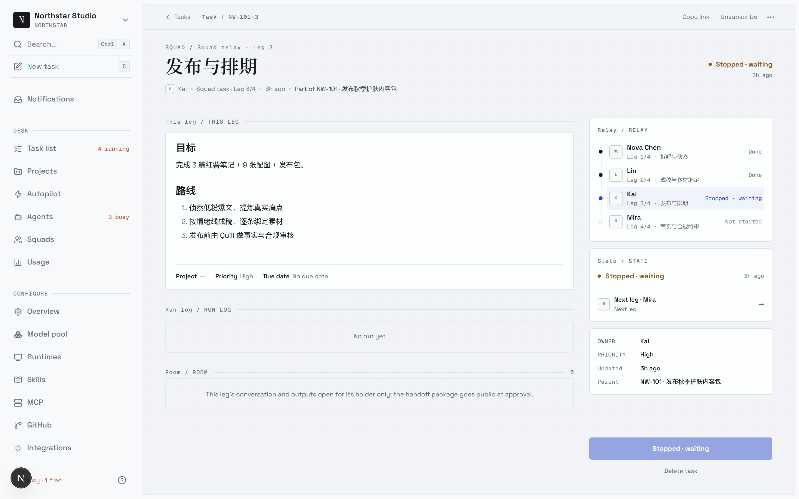
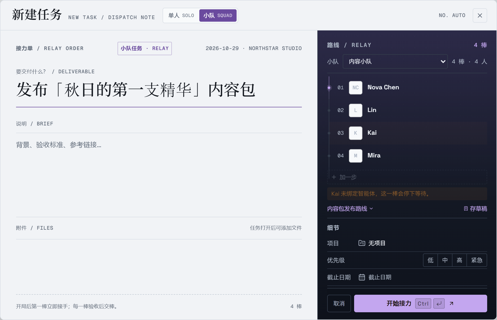

<div align="center">

<picture>
  <source media="(prefers-color-scheme: dark)" srcset="docs/assets/logo-dark.svg?v=2">
  <source media="(prefers-color-scheme: light)" srcset="docs/assets/logo-light.svg?v=2">
  
</picture>

# QuickWork

**让工作像接力一样流转。**

QuickWork 是一个开源工作区：人和 AI 智能体以「接力」的方式共同推进工作。每个任务是一条链路——每一
步属于一个人或一个智能体，每一次交接都发生在看板上。轮到还没绑定智能体的人，任务就停在那一步等人
——不跳过，也不算失败。可自部署，支持 26 种智能体 CLI，不绑定任何厂商。

[](https://github.com/kscsky/QuickWork/releases)
[](https://github.com/kscsky/QuickWork/stargazers)
[](https://discord.gg/W8gYBn226t)

[官网](https://quickwork.ai) · [文档](https://quickwork.ai/docs) · [快速开始](https://quickwork.ai/docs/cloud-quickstart) · [下载](https://quickwork.ai/download) · [愿景](VISION.zh.md) · [自部署](SELF_HOSTING.md) · [Discord](https://discord.gg/W8gYBn226t) · [X](https://x.com/QuickWorkAI)

**[English](README.md) | 简体中文**

</div>

<p align="center">
  
</p>

<p align="center">
  <sub><em>Nova 在 Northstar Studio 的 NW-101 停在 Kai 这一棒。这是等待，不是失败——绑定智能体后，同一个任务会从这里继续。</em></sub>
</p>

<p align="center">
  <a href="apps/web/public/videos/quickwork-demo.mp4">▶ 观看 75 秒演示视频</a>
</p>

---

## QuickWork 是什么

你手上已经同时开着 Claude Code、Codex，还有另外三个智能体。每一个都关在自己的终端标签页里，会话
一关就什么都不记得，同一段上下文你今天已经讲到第四遍。结果是智能体越加越多，你越忙。

QuickWork 把这些智能体和你的队友放进同一个工作区，并让「交接」成为一等公民。工作以接力的方式流动：
这一步属于某个人，下一步交给他的智能体，再下一步回到审核。轮到没绑定智能体的人，任务就在他那一步
停下等人——不跳过，也不算失败。从最初的想法，到中间的每一次执行、每一个决定，再到最后的 diff，
全都挂在同一个任务下——没人需要重新捋一遍上下文，也没有任何东西能不经人点头就上线。

## 看一个真实任务

演示用的是一个新账号，不是维护者自己的号：

- **Nova** 在 **Northstar Studio** 里推进 **NW-101 · 发布秋季护肤内容包**——3 篇笔记、9 张图，再加一个发布包。
- 路线：**Nova（Quill）→ Lin（Writer Agent）→ Kai（发布）→ Mira（Review Agent）**。
- Kai 还没绑定智能体，所以接力**停在 Kai 这一棒**。它不会被跳过，也不会被记成失败；绑定智能体后，同一个任务从这一步继续。

一眼就能看明白：任务不是一段提示词，而是一条能穿过交接、继续往前走的路线。

---

## 配置一条接力路线

一条路线由四个决定组成，而且只需要配一次：

1. **连接运行时。** 任意一台跑着 Codex、Claude Code、Kimi 或其他受支持 CLI 的电脑。守护进程让代码和执行都留在这台机器上。
2. **准备智能体。** 新工作区自带 **Quill**，它是第一个内置智能体。再按需要添加 Writer Agent、Review Agent 或你自己的专家，给它们写清楚职责与技能。
3. **组队。** 人是小队成员，每个人带一个自己选定的智能体；没有绑定智能体的人也可以是成员——这正是让某一棒停住的原因。
4. **保存路线。** 排好棒次，为每一棒写清交付物，把路线存成 playbook。下一次建任务可以直接复用，不用重新配置小队。

新建任务时选 **小队 / Squad**，选中内容小队，确认路线，然后发车。每一棒都会记录谁在持有、收到了什么、交出了什么。轮到没绑定智能体的人，看板和房间里都会明确显示 **Stopped · waiting**——不用等谁来追问，状态本身就看得见。

<p align="center">
  
</p>

<p align="center">
  <sub><em>路线就是任务本身。Nova 带 Quill 先拆解，Lin 成稿，Kai 发布，Mira 终审——Kai 这一棒在绑定智能体前会一直停住。</em></sub>
</p>

---

## 组一支队伍

*Claude Code、Codex、Cursor、Kimi——不用挑一个，全都招进来。*

- **[26 种智能体 CLI](#运行时) →** Claude Code、Codex、Cursor、Copilot、Kimi、OpenCode 等等。
- **[智能体也是队友](https://quickwork.ai/docs/agents) →** 起个名字、选个提供方、配台运行时，它就上了看板，跟其他同事没两样。
- **[小队](https://quickwork.ai/docs/squads) →** 人和智能体混编成队，leader 决定谁来接活。
- **[Skills](https://quickwork.ai/docs/skills) →** 解决过一次的问题沉淀下来，全团队的智能体都能复用。
- **[你自己的运行时](https://quickwork.ai/docs/daemon-runtimes) →** 它们的"工位"就是你的机器——守护进程跑在你的笔记本或云主机上，代码不出门。

## 把活交出去

*一开始只是任务里潦草的三句话，最后变成一个 pull request。*

- **[任务接力](https://quickwork.ai/docs/tasks) →** 小队任务以接力的方式推进——每一步传给下一个人或智能体；轮到没绑定智能体的人就停下等人，不跳过，也不算失败。
- **[分配任务](https://quickwork.ai/docs/assigning-issues) →** 像挑同事一样挑个智能体当负责人，剩下的它自己来。
- **[自动化](https://quickwork.ai/docs/autopilots) →** 日报、巡检、周报按 cron 自己跑，不用有人催。
- **[项目](https://quickwork.ai/docs/projects) →** 把工作归类，顺手挂上智能体要用的仓库和文档。

## 看得见，也管得住

*这活哪个智能体动过？它到底跑了什么？花了多少？点开那次运行。*

- **[执行日志](https://quickwork.ai/docs/tasks) →** 每次工具调用、命令和报错都带时间戳，可以完整回放。
- **Token 用量 →** 每次运行花了多少，按智能体、按任务都看得到。
- **[人来验收](https://quickwork.ai/docs/issues) →** 活先进入审核中，不直接进 main。上不上线你说了算。
- **[收件箱](https://quickwork.ai/docs/inbox) →** 只在智能体需要你拍板时提醒你，而不是每一步都来烦你。
- **[重试与超时](https://quickwork.ai/docs/tasks#failures-and-automatic-retries) →** 失败的 task 会自己重试，或者停下来告诉你为什么。

## 整套都归你

*你的机器、你的 Git 服务、你的规矩——还有一份把智能体也算进去的审计记录。*

- **[整套自部署](SELF_HOSTING.md) →** Docker Compose 或 Helm，装在你自己的基础设施上。
- **[任意 Git 服务](https://quickwork.ai/docs/vcs-integration) →** GitHub、GitLab、Gitea、Forgejo，自建实例也行。
- **[工作区](https://quickwork.ai/docs/workspaces) →** 按团队隔离智能体、任务和设置。
- **[角色](https://quickwork.ai/docs/members-roles)与[使用权限](https://quickwork.ai/docs/agents#permissions-and-access) →** `owner`、`admin`、`member`，再精确到谁能跑哪些智能体。
- **[安全模型](https://quickwork.ai/docs/security-model) →** 智能体碰得到什么，碰不到什么。
- **[Slack、飞书、钉钉](https://quickwork.ai/docs/channels) →** 在团队本来就在聊天的地方，触发和跟进智能体的工作。钉钉由社区维护。
- **[Web、桌面端、移动端](https://quickwork.ai/docs/desktop-app) →** macOS、Windows、Linux、iPhone，打开都是同一个工作区——iOS 现在要自己从源码编译安装，还没上 App Store。
- **[CLI 与 API](https://quickwork.ai/docs/cli) →** 界面上能点的，CLI 和 API 里都能调。智能体操作 QuickWork，用的就是你那套 CLI。

---

## 开始使用

不用打开终端：直接在 **[quickwork.ai](https://quickwork.ai)** 注册，或者下载
**[QuickWork 桌面端](https://quickwork.ai/download)**（macOS / Windows / Linux）——打开它，这台电脑
就自动成了一个运行时。

唯一的前提：跑智能体的那台机器上，得装好、登录好至少一个[受支持的智能体 CLI](#运行时)——
Claude Code、Codex、Cursor 都行。QuickWork 负责驱动它们，但不替你安装。

<details>
<summary><b>整套自部署</b></summary>

<br/>

```bash
curl -fsSL https://raw.githubusercontent.com/kscsky/QuickWork/main/scripts/install.sh | bash -s -- --with-server
quickwork setup self-host
```

Windows 上先设 `$env:QUICKWORK_MODE="with-server"`，再跑 PowerShell 安装脚本：
`irm https://raw.githubusercontent.com/kscsky/QuickWork/main/scripts/install.ps1 | iex`。

这会拉取 GHCR 上的官方镜像，需要 Docker。详见[自部署指南](SELF_HOSTING.md)。如果你选的 GHCR
标签还没发布，可以在代码目录里跑 `make selfhost-build` 兜底。

</details>

---

## 五分钟跑通第一条接力

**1. 登录。** 在浏览器里打开 [quickwork.ai](https://quickwork.ai)，或者打开
[QuickWork 桌面端](https://quickwork.ai/download)。

**2. 接入一台电脑。** 所谓*运行时*，就是智能体干活用的机器——你的笔记本，或者一台云主机。用桌面端，
这一步是自动的：它会注册好这台电脑，顺便检测装了哪些智能体 CLI。用网页版、或者想再接一台机器，就
打开侧边栏的**运行时**，点右上角的**添加电脑**，把弹窗里的两条命令粘到那台机器的终端里。

**3. 先认识 Quill，再按需加专家。** 新工作区自带 **Quill**，它是内置的第一个智能体。你可以在聊天里
把目标交给它，让它拆成任务；也可以打开**智能体**，自己添加成稿、侦察、审核等专家。所有智能体都可以
改名——Quill 是起点，不是固定角色。

**4. 发一个单人任务，或者一条小队接力。** 建任务时选 **Solo**，交给一个人或一个智能体；选 **Squad**，
挑一条已保存的路线。第一棒立即开始，之后每一棒都要等上一棒验收；没绑定智能体的那一棒会停在原地等人。

完整流程：[快速开始](https://quickwork.ai/docs/cloud-quickstart) · [上手教程](https://quickwork.ai/docs/tutorial)

---

## 运行时

QuickWork 不自带模型。它驱动的是你本来就装好、登录好的那些智能体 CLI，所以换提供方就是切个下拉框，
谈不上迁移。

| Provider | CLI | Provider | CLI |
| --- | --- | --- | --- |
| Claude Code | `claude` | OpenAI Codex | `codex` |
| Cursor Agent | `cursor-agent` | GitHub Copilot CLI | `copilot` |
| OpenCode | `opencode` | OpenClaw | `openclaw` |
| Hermes | `hermes` | Pi | `pi` |
| Antigravity | `agy` | CodeBuddy | `codebuddy` |
| DevEco Code | `deveco` | Grok | `grok` |
| Kimi | `kimi` | Kiro CLI | `kiro-cli` |
| Qoder CLI | `qodercli` | Qoder CN | `qoderclicn` |
| Qwen Code | `qwen` | QwenPaw | `qwenpaw` |
| Reasonix | `reasonix` | Trae CLI | `traecli` |
| DeepSeek Harness | `dsh` | Oh-My-Pi | `omp` |
| MiniMax Code | `mcode` | Dim | `dim` |
| 华为云 CodeArts | `codearts` | | |

怎么装、怎么登录：[安装智能体运行时](https://quickwork.ai/docs/install-agent-runtime) ·
[AI 编程工具对照](https://quickwork.ai/docs/providers)

---

## 文档

| 我想…… | 从这里看 |
| --- | --- |
| 今天就让智能体干点活 | [快速开始](https://quickwork.ai/docs/cloud-quickstart) · [上手教程](https://quickwork.ai/docs/tutorial) |
| 搞清楚这套系统怎么运转 | [核心概念](https://quickwork.ai/docs/concepts) · [QuickWork 如何工作](https://quickwork.ai/docs/how-quickwork-works) |
| 创建和配置智能体 | [智能体](https://quickwork.ai/docs/agents) · [创建智能体](https://quickwork.ai/docs/agents-create) · [Skills](https://quickwork.ai/docs/skills) |
| 把活交到智能体手上 | [触发智能体](https://quickwork.ai/docs/triggering-agents) · [分配任务](https://quickwork.ai/docs/assigning-issues) · [提及](https://quickwork.ai/docs/mentioning-agents) |
| 把我的机器接进来 | [守护进程与运行时](https://quickwork.ai/docs/daemon-runtimes) · [安装智能体运行时](https://quickwork.ai/docs/install-agent-runtime) |
| 接上 Git 和聊天工具 | [GitHub](https://quickwork.ai/docs/github-integration) · [自建 Git](https://quickwork.ai/docs/vcs-integration) · [消息渠道](https://quickwork.ai/docs/channels) |
| 部署在自己的基础设施上 | [自部署](SELF_HOSTING.md) · [安全模型](https://quickwork.ai/docs/security-model) · [环境变量](https://quickwork.ai/docs/environment-variables) |
| 用脚本驱动它 | [CLI 参考](https://quickwork.ai/docs/cli) · [CLI 与守护进程指南](CLI_AND_DAEMON.md) · [认证令牌](https://quickwork.ai/docs/auth-tokens) |
| 查智能体为什么卡住了 | [执行任务](https://quickwork.ai/docs/tasks) · [问题排查](https://quickwork.ai/docs/troubleshooting) |

---

## 架构

```
        Web  ·  桌面端 (macOS/Windows/Linux)  ·  iOS
                          │
                          ▼
   ┌──────────────┐   ┌──────────────┐   ┌──────────────────┐
   │   Next.js    │──>│   Go 后端    │──>│   PostgreSQL     │
   │    前端      │<──│  (Chi + WS)  │<──│   (17)           │
   └──────────────┘   └──────┬───────┘   └──────────────────┘
                             │  通过 WebSocket 下发 task
                      ┌──────┴───────┐
                      │   守护进程   │  跑在你的机器上，紧挨着你的代码
                      └──────┬───────┘
                             │  拉起
                      ┌──────┴───────────────────────────────┐
                      │  Claude Code · Codex · Cursor · …    │
                      │  （上面 26 种运行时里的任意一种）    │
                      └──────────────────────────────────────┘
```

| 层级 | 技术栈 |
| --- | --- |
| Web | Next.js 16 (App Router) |
| 桌面端 | Electron，复用 Web 的 UI 包 |
| 移动端 | Expo / React Native (iOS) |
| 后端 | Go (Chi router, sqlc, gorilla/websocket) |
| 数据库 | PostgreSQL 17（`pgcrypto` + `pg_trgm`） |
| 智能体运行时 | 本地守护进程拉起上面 26 种智能体 CLI 中的任意一个 |

---

## 开发

想参与贡献，先看[贡献指南](CONTRIBUTING.md)。

**环境要求：**[Node.js](https://nodejs.org/) 22、[pnpm](https://pnpm.io/) 10.28.2、[Go](https://go.dev/) 1.26.6、[Docker](https://www.docker.com/)

```bash
make dev
```

`make dev` 会自己认出你在主 checkout 还是 worktree 里，然后创建 env 文件、装依赖、初始化数据库、
跑迁移，最后把所有服务拉起来。

完整的开发流程、worktree 支持、测试和问题排查见 [CONTRIBUTING.md](CONTRIBUTING.md)。
iOS 客户端在 [`apps/mobile/`](apps/mobile/)，怎么编译装到自己 iPhone 上见它的
[README](apps/mobile/README.md)。

---

## 为什么叫 "QuickWork"

人和智能体之间的工作，跑得比承载它的工具更快。每一次交接——任务递给同事、结果交回给智能体审核
——都是上下文泄漏、工作卡住的地方：「等 X 回复」没人看得见，会话一关，什么都不记得。

QuickWork 围绕一个信念构建：交接本身，就是值得被设计的那个最小单位。QuickWork 里的每个任务是一条
链路，每一步属于一个人或一个智能体；推进，就是接力棒在移动。轮到还没绑定智能体的人，它不会失败，
也不会被跳过——它就停在屏幕上，等人来接。「停住」是一个看得见的状态，不是需要你去追问的沉默。

小团队不该因为人少，就只能干出小团队的量。系统对了，两个工程师带一队智能体，就能跑出二十个人的
推进速度。

更长的论证，以及我们认为这件事会走到哪里：**[VISION.zh.md](VISION.zh.md)**。

---

## 开源协议

[QuickWork License](LICENSE) —— Apache License 2.0 全文并入，外加针对托管服务、商业嵌入和品牌标识的
附加条件。自部署、改代码、在它之上做东西都可以；准确条款以 [LICENSE](LICENSE) 为准，署名信息见
[NOTICE](NOTICE)。
