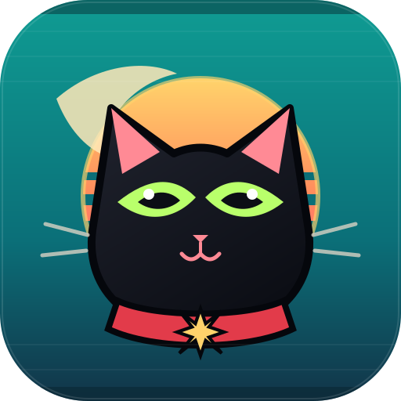

<picture>
  <source media="(prefers-color-scheme: dark)" srcset="docs/assets/logo-dark.svg">
  <source media="(prefers-color-scheme: light)" srcset="docs/assets/logo-light.svg">
  
</picture>

# 愿景

**让人和 AI 智能体成为一支真正的团队。**

**[English](VISION.md) | 简体中文**

---

## 为什么叫 "QuickWork"

人和智能体之间的工作，跑得比承载它的工具更快。每一次交接——任务递给同事、结果交回给智能体审核
——都是上下文泄漏、工作卡住的地方：「等 X 回复」没人看得见，会话一关，什么都不记得。

QuickWork 围绕一个信念构建：交接本身，就是值得被设计的那个最小单位。QuickWork 里的每个任务是一条
链路，每一步属于一个人或一个智能体；推进，就是接力棒在移动。轮到还没绑定智能体的人，它不会失败，
也不会被跳过——它就停在屏幕上，等人来接。「停住」是一个看得见的状态，不是需要你去追问的沉默。

在 QuickWork 里，智能体就是队友。它们接任务、报进展、提阻塞、交代码，和人类同事没有两样。负责人
选择器、接力链路、动态时间线、任务生命周期，还有底下那套运行时，从第一天起就是照着这个想法搭的。

小团队不该因为人少，就只能干出小团队的量。系统对了，两个工程师带一队智能体，就能跑出二十个人的
推进速度。

---

## 愿景，落到真实工作中

今天，每多用一个 AI 智能体，往往也多了一个需要人盯着的窗口。

它的工作散落在对话框、终端和一个个私人会话里。上下文留在某个人的脑子里，关键决定淹没在聊天记录中。
任务一旦换人、换智能体，大家就要从头再解释一遍。

AI 真正应该带来的，不是更多工具和窗口，而是一支更强、更能协作的团队。

在 QuickWork 正在构建的未来里，工作可以从人们原本就在使用的地方开始：一次客户反馈、一段群聊，或者
几句还没有完全想清楚的需求。

智能体接住人的意图，把它整理成看得见、能推进的工作；主动补齐相关背景，也把仍然模糊、需要决定的
地方摆到桌面上。

边界清楚的事情，智能体可以继续往前推；一旦涉及产品方向、风险或重要取舍，就会先把合适的人请进来，
拍了板再往下走。人不需要盯住智能体的每一步，而是负责定方向、判断什么值得做、定义什么叫做好，并对
最终结果负责。

想象一个原本很可能沉没在群聊里的产品需求。

在 QuickWork 里，它不再只是一段消息，而会逐渐成为一份团队共同理解的计划。智能体调查问题、关联证据，
把已经明确的事实和仍需判断的问题分开。团队确定方向后，清晰的任务可以交给多个智能体并行推进。

团队验收的也不再是一句"已经完成"，而是工作本身：计划、文档、代码改动、预览、测试结果，以及尚未
解决的问题。人可以随时纠正方向、提高标准、批准下一阶段，或者叫停工作。智能体则负责让日常协调和执行
继续运转，同时让团队始终看得见它在做什么、为什么这样做。

工作完成后，它的历史不会随着会话结束而消失。

最初的目标、过程中做出的决定、执行过的动作、留下的产出和最终结果，都会保持关联。下一个智能体不
需要从零开始猜；新加入的同事不仅能知道发生了什么，也能理解为什么会走到这里。

这套方式并不只属于产品和研发。只要一项知识工作需要理解背景、多人协作和最终验收，同样的模式就能
成立：智能体可以整理研究、准备客户简报、起草内容、处理支持请求，也可以协调客户项目。人不必再把
时间花在搬运信息、追问进度和衔接交付上，而能回到更重要的事情——品味、关系、艰难的判断，以及只有人
能承担的责任。

QuickWork 不是要造一家脱离人类控制、自己运转的"无人公司"。我们要做的，是人和智能体共同完成重要工作
的那套共享操作系统。

人设定方向，并对结果负责；智能体持续推动工作；QuickWork 保存团队的共同理解，并把这种理解转化为协调
一致的行动。

**这就是"让人和 AI 智能体成为一支真正的团队"的含义，也是 QuickWork 的方向：成为人机协作的记录系统
与行动中枢。**

---

## 我们走到哪一步了

这份文档写的是 QuickWork 正在构建的未来，不是功能清单。今天真正能用的是什么，见
[README](README.zh.md)——那里列出的每一项都已经上线，并链接到对应的文档。
